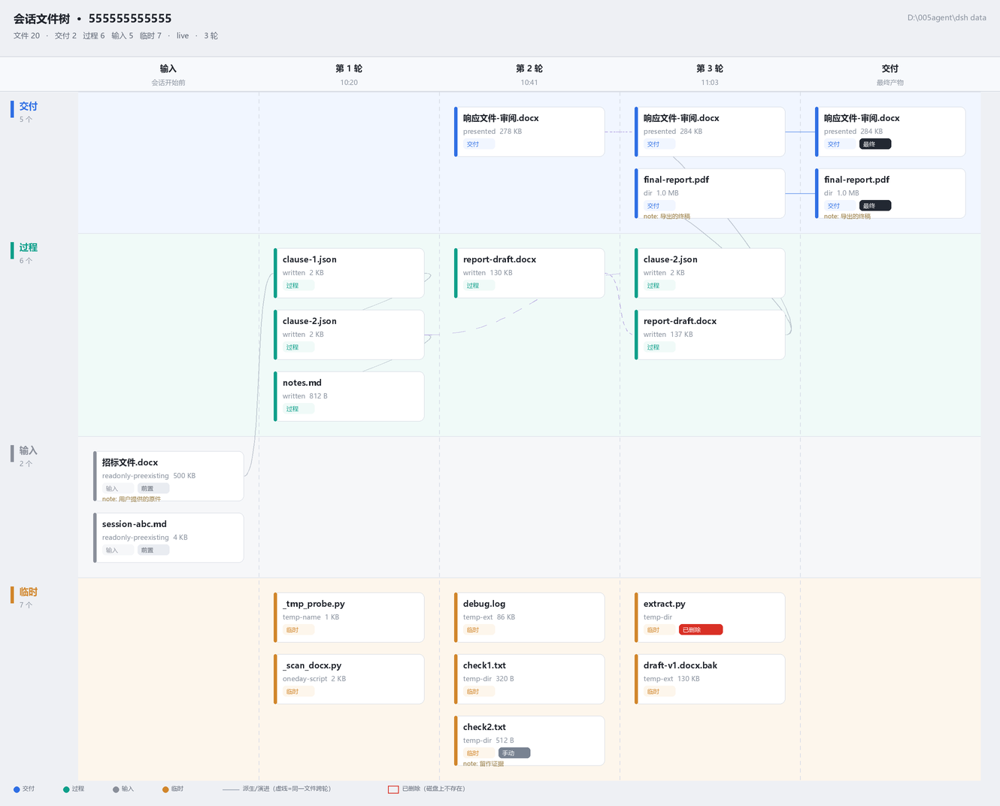

# dsh-session-files · Session File Tree

A per-session **file provenance tree** for DSH (DeepSeek Harness): every file a session read, wrote, generated or deleted, laid out left-to-right by turn, split into **deliverable / process / input / temp** lanes, with one-click, recoverable cleanup of throwaway scripts and logs.

> DSH plugin. Host half + Web client half, no runtime dependencies, plain ESM.
>
> 中文: [README.md](README.md)



## Why

An agent's real mess is not in git — it is in the working directory: `_tmp_probe.py`, `debug.log`, `verify/`, `page-1.png`, `report-v1.bak.docx`. In a real 500-file session directory we measured **216 files of process garbage** sitting next to the final deliverable. Three problems:

1. **No provenance** — which file came from which turn, which one is the final version, what overwrote what.
2. **No lifecycle class** — throwaway scripts, keep-worthy intermediates, user-provided inputs and final deliverables are all equal to the filesystem.
3. **Cleanup is unsafe** — you cannot tell what to delete, and deleting is irreversible.

This plugin collapses those into **one tree, four lanes, one recoverable cleanup**.

## Features

- **Left → right timeline tree**: columns = `input` (existed before the session) + one column per turn + `deliverable`; rows = four lanes.
- **Four lanes** — `deliverable` / `process` / `input` / `temp`, auto-classified by extension, directory, pre-existence and `present` usage; any node can be overridden manually and the override persists.
- **Card details**: action (read / write / edit / exec / present / delete), size, turns, classification reason (`temp-ext`, `temp-dir`, `one-day-script`, …), note, `deleted` / `final` / `manual` badges.
- **Click a card**: drawer with a text/binary preview, lane override and free-form note.
- **"N more not shown" chip**: the tree only draws files the session actually touched; scanned-but-untouched historical junk is listed in a popover — exactly what "clean up every temp file" has to cover.
- **Two-step cleanup**: `dryRun` first to get an authoritative count, confirm, then move into `$DSH_HOME/session-files/trash/<session>/<timestamp>/` — never a hard delete.
- **Agent tool** `session_files` (`list` / `classify` / `cleanup`) plus a 4-line system-prompt section, so the agent tidies up after itself.
- Theme-token colors only (`--dsw-alias-*`), light and dark friendly.

## Install

Requires the DSH desktop app with the Web GUI.

```text
plugin_manager action=install_bundle target=<absolute path to this repo>
```

Success looks like: a `[session-files]` prompt section, a `session_files` tool, and an `include:session-files` plugin row in `active` state. Then refresh the page (F5): a tree button appears at the right of the composer.

> ⚠️ Host-half code changes require a **DSH process restart** (Node caches loaded ESM); client-half changes reload with the page.

## Usage in one screen

Open the tree from the composer button. Read columns as turns and rows as lanes. Click a card to preview, reclassify or annotate. Press "cleanup" to move every `temp` path to the trash after a dry run. Let the agent do the same through the `session_files` tool. Details and the HTTP contract: [docs/USAGE.md](docs/USAGE.md). Contributing and release process: [docs/MAINTAINING.md](docs/MAINTAINING.md).

## Known limitations

- **The visual layer was not verified in a real browser** (no browser control in the dev environment): the UI is covered by a minimal hooks-runtime render harness plus layout unit tests, and the screenshot comes from the same layout function rendered offline. Please file an issue if styles break.
- `exists` does not track files removed by shell commands between tool calls.
- Session logs are multi-frame zstd; a corrupted frame degrades to `warnings:['log-unreadable']`.
- Paths touched outside the workspace are reported as `outside-workspace` warnings rather than tracked.

## License

MIT © 2026 Xzl21
