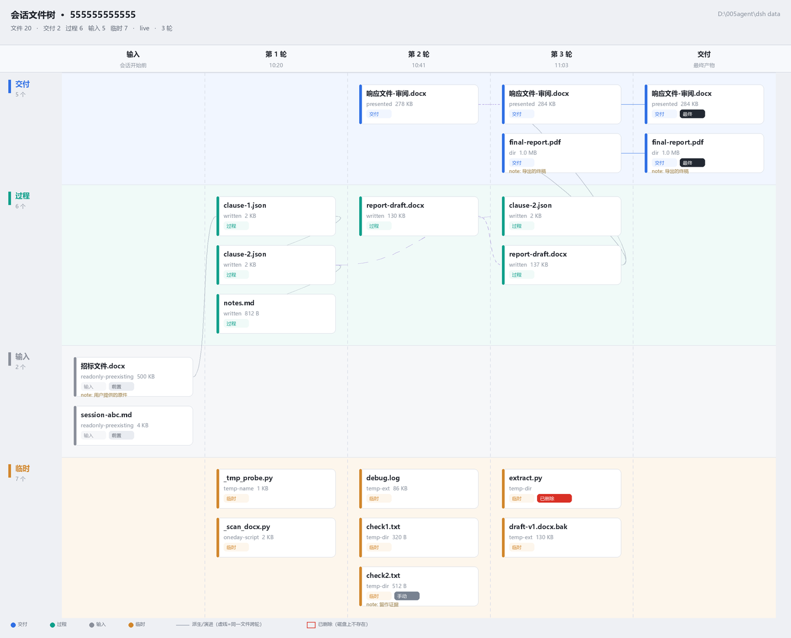

# dsh-session-files · 会话文件树

给每个会话（session）一份**文件血统清单**：这个会话读过、写过、生成过、删过哪些文件，按「第几轮」从左到右铺开，并按 **交付 / 过程 / 输入 / 临时** 四条道分开标注，一键把一次性脚本和日志收进可恢复的回收站。

> DSH（DeepSeek Harness）插件。Host 半 + Web Client 半，无外部依赖，纯 ESM。
>
> English: [README.en.md](README.en.md)



## 这个插件解决什么

Agent 干活的真实垃圾场不在 git 里，而在你的工作目录里：`_tmp_probe.py`、`debug.log`、`verify/`、`page-1.png`、`xxx-v1.bak.docx`……实测一个跑了 500+ 文件的会话目录里，**216 个是过程垃圾**，但它们和最终交付物混在同一层。痛在三处：

1. **没有血统**：谁生成这个文件、第几轮生成的、被谁改写、最终版是哪个，只看目录看不出来。
2. **没有生命周期分类**：临时脚本（用完即删）、过程产物（可能要留）、用户输入（agent 不该动）、最终交付，在文件系统里是平权的。
3. **清理不敢下手**：不知道该删什么，删错了也没法还原。

这个插件把这三件事收敛成：**一张树 + 四条道 + 一个可恢复的清理按钮**。

## 功能

- **左 → 右的时间线树**：列 = `输入`（会话开始前就在的文件）+ 每一轮 + `交付`（最终产物）；行 = 四条道。
- **四道分类**：`交付` / `过程` / `输入` / `临时`，默认按扩展名、目录名、是否 preexisting、是否被 present 等规则自动判，任何一条都能手动改（override 会持久化）。
- **卡片信息**：动作（read / write / edit / exec / present / delete）、体积、所在轮次、判定原因（如 `temp-ext`、`temp-dir`、`one-day-script`）、备注、`已删除`/`最终`/`手动` 徽章。
- **点击卡片**：右侧抽屉里预览文件内容（文本/二进制判定）、改分类、写备注。
- **「另有 N 个未展开」**：树只画本会话触碰过的文件；扫描到但从未触碰的历史垃圾会单独给一个 chip，点开能看到完整清单——这正是「清理全部临时文件」真正要覆盖的部分。
- **一键清理（两步）**：先 `dryRun` 拿权威数量给你确认，确认后才真正移入 `$DSH_HOME/session-files/trash/<session>/<时间戳>/`，**永不直接删除**。
- **给 agent 的工具**：`session_files`（`list` / `classify` / `cleanup`），并注入 4 行系统提示词，让 agent 在工作收尾时自己交作业、自己扫垃圾。
- **暗色/亮色**：颜色全部走 `--dsw-alias-*` 主题 token。

## 安装

要求：DSH 桌面版（带 Web GUI），已能打开插件管理器。

把本仓库放到任意位置，然后在会话里让 agent 执行（`plugin_manager` 是 DSH 内置工具）：

```text
plugin_manager action=install_bundle target=<本仓库绝对路径>
```

或者用 CLI 等价操作（取决于你的 DSH 版本）：`dsh plugin install <path>`。

安装成功的标志：

1. 系统提示词里出现 `[session-files]` 开头的 4 行；
2. 工具表里出现 `session_files`；
3. 插件列表出现 `include:session-files`，状态 `active`。

装完 **刷新页面（F5）**：输入框右侧出现一个树图标按钮。

> ⚠️ **改动 host 半代码后必须重启 DSH 进程**才能生效（Node ESM 会缓存已加载的 host 模块），client 半则随页面刷新/HMR 更新。

## 使用

### 1. 打开树

点输入框右下角的树图标 → 全屏画布打开。`Esc` 逐层退出（抽屉 → 全屏）。

### 2. 读这张图

```
列： 输入(会话开始前)  第 1 轮   第 2 轮   …   交付(最终产物)
行： 交付 ─────────────────────────────────────────
     过程 ─────────────────────────────────────────
     输入 ─────────────────────────────────────────
     临时 ─────────────────────────────────────────
```

- 卡片之间的连线：`派生`（同一路径跨轮演化）、`交付`（present 关系）、`来源`（读取/引用关系）。
- 顶部状态带分两段读：**文件级**（工作区扫描到的总数 + 四类计数）与**可视图**（树里画出的节点数）。两者不相等是正常的，差额就是「未展开」的那部分。

### 3. 改分类 / 写备注

点卡片 → 抽屉里选 `交付 / 过程 / 输入 / 临时`，可加一句备注（例如「用户原始文件，别动」）。override 存在 `$DSH_HOME/session-files/overrides/<sessionId>.json`，重开树依然生效。

### 4. 清理临时文件

点「清理」→ 插件先做一次 `dryRun`，弹出「将把 187 个临时文件移入回收站（其中 180 个未在树中）」→ 确认才执行。

- 移入的是 `$DSH_HOME/session-files/trash/<sessionId>/<epochMs>/<相对路径>`，可随时手动还原。
- 只动被判为 `temp` 的路径；`.git`、`node_modules`、`.venv` 等目录整个跳过，符号链接不跟随。

### 5. 让 agent 自己收尾（可选）

系统提示词已经要求 agent 在结束任务前：

```text
session_files { action: "list" }                                  # 看这个会话留下了什么
session_files { action: "classify", paths: ["_probe.py"], cls: "temp" }
session_files { action: "cleanup", dryRun: true }                 # 先看清单
session_files { action: "cleanup" }                               # 再执行
```

详细参数与 HTTP 接口见 [docs/USAGE.md](docs/USAGE.md)。

## 已知限制

- **视觉部分未在真实浏览器中验证**：开发环境无法开浏览器，UI 的正确性靠「Node 里用最小 hooks 运行时真渲染 + 布局函数单测」保证，截图是同一套布局函数离线渲染的。首次打开若发现样式问题，请提 issue。
- `exists` 字段对「用 shell 命令删掉的文件」不敏感（只能看到工具调用与扫描时刻的状态），卡片可能仍显示为存在。
- 会话日志是多帧 zstd 拼接，读取器已按魔数切帧处理；极端损坏的日志会以 `warnings:['log-unreadable']` 降级。
- 目前只覆盖会话与工作区文件，不追踪工作区之外被读写的路径（会以 `outside-workspace` warning 提示）。

## 开发

```bash
# 测试（Windows 下 node 可能不在 PATH，用 DSH 自带运行时）
node test/ledger.test.mjs            # 台账核心，纯函数
node test/client-layout.test.mjs     # UI 布局 + 渲染断言
node test/integration.real.mjs       # 真实 DSH 环境端到端（含 dryRun 金丝雀）
```

设计契约见 [CONTRACT.md](CONTRACT.md)（数据形状、HTTP 契约、分类规则、文案表——改行为先改契约）。维护流程见 [docs/MAINTAINING.md](docs/MAINTAINING.md)。

## 目录

```
index.js              host 半：4 条 HTTP 路由 + session_files 工具 + 系统提示词
client.js             client 半：composer 按钮 + 全屏树画布（单文件，无构建）
host/ledger.mjs       台账核心：事件 → 文件操作 → 分类 → 树（纯函数，无 IO）
host/store.mjs        override 持久化、trash、预览
host/logreader.mjs    多帧 zstd 会话日志读取
locale/               中英文显示名
CONTRACT.md           实现契约（唯一真相）
test/                 三套测试
tools/                离线渲染工具（把真实 ledger 画成 PNG）
preview/              预览图
reports/              QA 报告
```

## License

MIT © 2026 Xzl21
